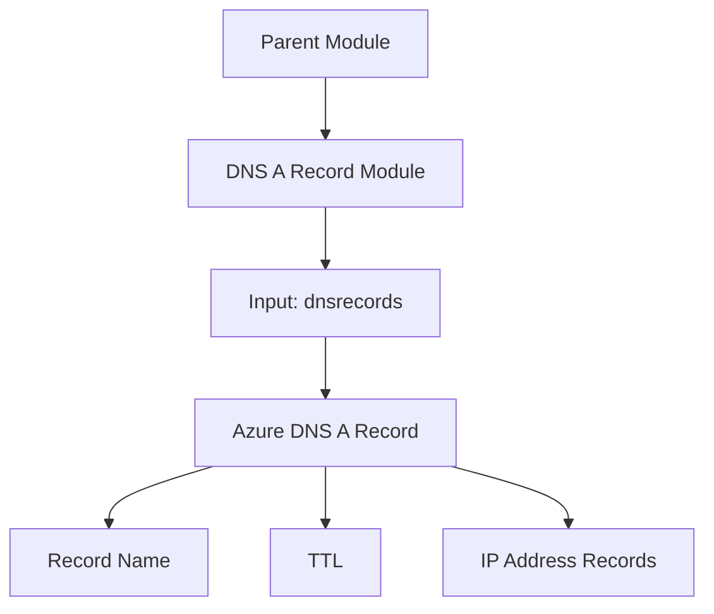

# Terraform Azure DNS A Record Module

A reusable Terraform module for managing Azure DNS A Records through configuration-driven resource creation.

## Architecture



## Resource

The module uses `azurerm_dns_a_record` to configure DNS A Records in Azure DNS Zones.

The `for_each` expression allows multiple records to be managed from a map of inputs.

## Input Configuration

Each DNS record configuration includes:

- `name` — DNS record name.
- `zone_name` — DNS Zone name.
- `resource_group_name` — Resource Group containing the DNS Zone.
- `ttl` — DNS record time to live in seconds.
- `records` — List of IPv4 addresses for the A Record.

Example input:

```hcl
dnsrecords = {
  record01 = {
    name                = "test"
    zone_name           = "dns-preprod-lab.com"
    resource_group_name = "rg-lms-idn-preprod-01"
    ttl                 = 300
    records             = ["10.0.180.17"]
  }
}
```

Replace the example IP with an appropriate address for your environment.

## Usage

```hcl
module "dnsrecord" {
  source     = "git::https://github.com/sharanjeetaulakh/terraform-azure-dns-a-record.git"
  dnsrecords = var.dnsrecords
}
```

The DNS Zone and referenced Resource Group must exist before the A Record is provisioned. Configure the parent module dependencies to ensure the required ordering.

## Purpose

This module keeps DNS A Record configuration reusable and separate from the parent infrastructure orchestration.
